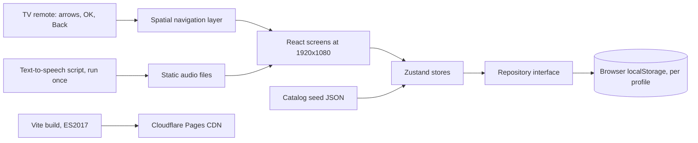

# Smart TV Book Streaming: Case Study

> A "Netflix for books" demo for Smart TV browsers: pick a profile, browse a catalog, and read a chapter one paragraph at a time with the remote control.
> **Source code is private.** This repository documents the project; a live walkthrough is available on request.

**Status:** in development (web version live for investor demos; the TV rollout is the next stage).

## The problem

A startup wanted to pitch investors on reading as a living room experience, the way people already binge series on TV. They needed a demo that felt like a real streaming app on a 10-foot screen, worked with nothing but a TV remote, and could run in any TV browser without an app store release.

## What I built

- **Profiles and home**: four household profiles, a rotating featured title, and a "Continue reading" rail that remembers where each person stopped.
- **Title details**: synopsis, chapters list, bookmarks, and favorite authors, saved per profile.
- **Paragraph-by-paragraph player**: one paragraph on screen at a time; left and right arrows move through the text and across chapters, and long paragraphs shrink and scroll to stay readable from the couch.
- **Reading settings**: three themes (dark, light, black), three font families, and line spacing, each remembered per profile, plus a text-only mode that hides the controls.
- **Save a passage**: one button stores the current paragraph as a highlight, without duplicates, and it shows up later in the "My stuff" area.
- **On-screen keyboard search**: search by title or author, ignoring accents and case, with theme chips (Courage, Love, Adventure, Family).
- **Narration pipeline**: a script that pre-generates audio for each paragraph with a text-to-speech model, so the player can read aloud with real elapsed time and auto-advance, served as static files.
- **55 public-domain works** in the catalog, with period covers from Wikimedia Commons and per-image license tracking.

## Architecture

- **Remote-first input**: every interaction works with only the arrow keys, OK, and Back; each screen sets focus on mount and restores the last focused item when you return.
- **One layout, any TV**: the UI is designed at 1920x1080 and scaled as a whole with a CSS transform, with a 5% safe area, so it needs no media queries.
- **Built for slow TV browsers**: ES2017 target, animations limited to transform and opacity, no UI kit, and a JavaScript budget under 300 KB gzipped (about 238 KB today, fonts excluded).
- **Offline friendly by design**: all state lives behind a repository interface over localStorage, so the demo never depends on the network during a pitch and can move to a cloud database later without touching the screens. Static hosting with hash routing, long-lived caching for hashed assets, and the demo kept out of search engines.

## Scale

- ~4.7k lines of TypeScript and TSX
- 11 test files
- 10 screens designed for TV

## My role

I owned the project end to end as the sole developer: turned the product brief and wireframes into a phased plan, defined the data model (profiles, works, passages, and notes anchored to stable paragraph indexes), built every screen, the remote-control navigation and the per-profile persistence, wrote the tests, set up the narration pipeline, and deployed the web version to Cloudflare Pages.

---
Built by **Victor Sestrem** · [LinkedIn](https://www.linkedin.com/in/victor-sestrem/) · victor-sestrem@hotmail.com
