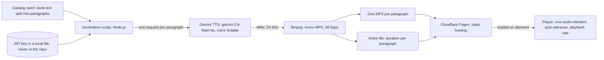

# Smart TV Book Streaming: Case Study

> A "Netflix for books" for Smart TV browsers: pick a profile, browse a catalog, and read (or listen to) a book one paragraph at a time, using nothing but the TV remote.
> **Source code is private.** This repository documents the project; a live walkthrough is available on request.

**Stack:** React 18, TypeScript, Vite, Zustand, React Router (hash routing), Norigin Spatial Navigation, CSS Modules, Gemini text-to-speech (gemini-3.8-flash-tts), ffmpeg, Cloudflare Pages.

**Status:** MVP demo for investor meetings. The web version is live; the rollout on a real Smart TV is the next stage.

## Problem → Solution

**Problem.** People binge series on the living room TV, but reading has no equivalent there. A startup wanted to show investors what a book streaming service on a 10-foot screen could feel like, and it had to work with only a remote control, in any TV browser, without an app store release.

**Solution.** A streaming-style web app designed at 1920x1080 for the TV: household profiles, a rotating featured title, rails of covers, a title page, and a reader that shows one paragraph at a time. Every screen is driven by arrows, OK, and Back. The opening of a selected book can also be read aloud, with the narration advancing paragraph by paragraph.

## What I built

- **Profiles and home**: four household profiles, a rotating featured title, and a "Continue reading" rail that remembers where each person stopped.
- **Title page**: synopsis, chapter list, bookmarks, and favorite authors, saved per profile. Reading starts at the very beginning (preface included), with a one-click "Skip preface".
- **Paragraph-by-paragraph player**: one paragraph on screen at a time; left and right move through the text and across chapters, and long paragraphs shrink and scroll to stay readable from the couch.
- **Reading settings**: three themes (dark, light, black), three font families, and line spacing, each remembered per profile, plus a one-button text-only mode that hides the player controls.
- **Save a passage**: one button stores the current paragraph as a highlight, without duplicates; it shows up later in the "My stuff" area.
- **On-screen keyboard search**: by title or author, ignoring accents and case, with theme chips (Courage, Love, Adventure, Family).
- **AI narration**: pre-generated text-to-speech audio for each paragraph, with real elapsed time, playback speed, and auto-advance to the next paragraph and chapter.
- **55 public-domain works** in the catalog, with period covers from Wikimedia Commons and per-image license tracking.

## AI highlight: narration with text-to-speech

The player can read a book aloud. Instead of synthesizing speech live on the TV (TV browsers have partial and unreliable support for the Web Speech API), the audio is **generated once, offline, and shipped as static files**.

- **One file per paragraph.** The reader already works paragraph by paragraph, so the audio follows the same anchor (a stable paragraph index). Turning a page, skipping, or resuming never needs to seek inside a long file.
- **Resumable generation.** The script skips files that already exist, pauses between requests (21 s by default), waits and retries on per-minute limits, and stops cleanly on the daily quota, so it can run in batches over several days without losing work.
- **Storage and caching.** Audio lives next to the app as static assets, outside the JavaScript bundle, and downloads only when the listener presses play. Hashed app files are cached for a year; the HTML always revalidates.
- **Cost.** The demo narrates the opening of one book (the full preface and the start of chapter one: 14 paragraphs, about 4 minutes of speech), generated entirely on the Gemini API free tier at no cost. That tier allowed 10 TTS requests per day for this model at the time, so a full book would need a paid tier or many daily batches. Playback costs nothing: no API is called at listening time.
- **Size.** About 48 kbps mono keeps speech clear: the 14 narrated paragraphs take about 1.5 MB, roughly 6 KB per second of speech.
- **Graceful fallback.** A paragraph without audio falls back to the silent reading mode, so partial narration never breaks the player.

## Technical challenges

- **Remote-only navigation (spatial focus).** Every action works with arrows, OK, and Back. A spatial navigation layer moves focus between rails and buttons; each screen sets focus on mount and restores the last focused item on return. Popups close on Back without leaving the reader, and the exit button is labeled and set apart from the settings menu to avoid accidental exits.
- **Performance on TV hardware.** TV browsers run older, slower Chromium builds. The app targets ES2017, animates only transform and opacity, uses no UI kit, and keeps the JavaScript under a 300 KB gzipped budget (about 95 KB for the app code, plus the catalog loaded as a separate chunk; fonts excluded). The whole UI is designed at 1920x1080 and scaled with a single CSS transform, with a 5% safe area.
- **Offline-friendly state.** All per-profile state sits behind a repository interface over localStorage, so a pitch never depends on the network, and the storage can move to a cloud database later without touching the screens.
- **Deployment.** Static build on Cloudflare Pages with hash routing (no server-side fallback needed), long-lived caching for hashed assets, an always-revalidated HTML entry, and noindex, nofollow headers to keep the demo out of search engines. Each release is checked after deploy: HTTP status, the served JavaScript hash matching the local build, and the response headers.

## Scale

- ~4.8k lines of TypeScript and TSX
- 11 test files
- 10 TV screens

## My role

Sole developer, end to end: turned the product brief and wireframes into a phased plan, defined the data model (profiles, works, passages, and notes anchored to stable paragraph indexes), built every screen, the remote-control navigation and per-profile persistence, designed and built the text-to-speech narration pipeline, wrote the tests, and deployed the web version.

---
Built by **Victor Sestrem** · [LinkedIn](https://www.linkedin.com/in/victor-sestrem/) · victor-sestrem@hotmail.com
